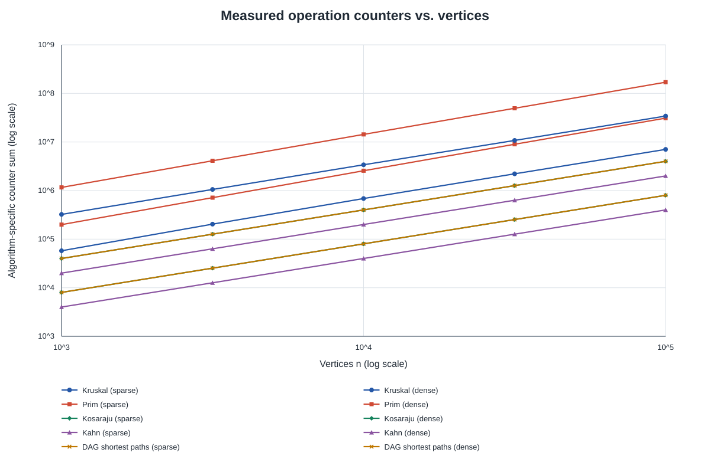
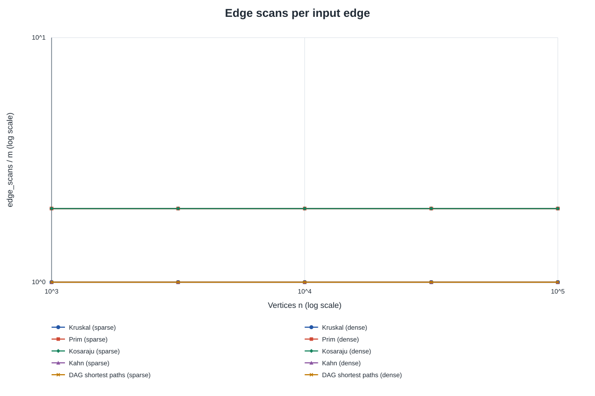
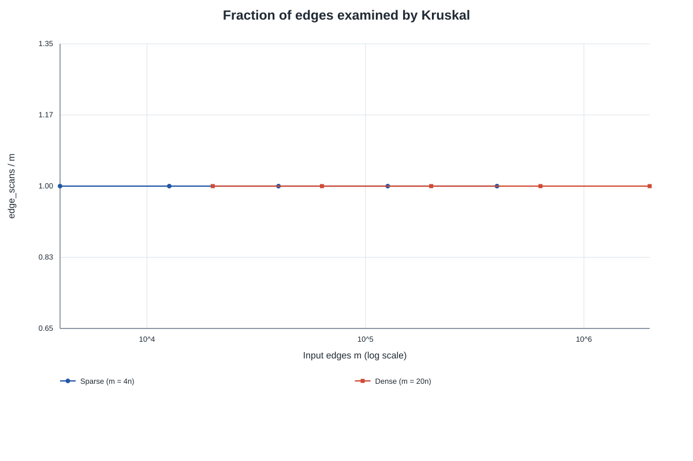

# Graph algorithms: correctness, complexity, and measured work

## Benchmark setup

This report uses the 50 committed rows in [`results/results.csv`](results/results.csv). The benchmark has five vertex counts (`1,000`, `3,162`, `10,000`, `31,623`, `100,000`) and two edge densities: sparse graphs with `m = 4n` and denser graphs with `m = 20n`. The plotted counter totals and ratios below are calculated directly from the CSV. They count instrumented algorithm work, not JVM instructions or elapsed time.

The benchmark also checks its results against these exact reference sequences, ordered by increasing `n`, with sparse then dense for each size:

| Result | Checked reference values |
|---|---|
| MST total weight | `147970, 30363, 468911, 97589, 1486139, 309550, 4715515, 968517, 15012094, 3056681` |
| Number of strongly connected components | `27, 1, 137, 1, 373, 1, 1188, 1, 3923, 1` |
| DAG total distance | `396274, 252411, 1271911, 723157, 3941828, 2381342, 12551891, 7376612, 40096539, 23512087` |

The MST values from Kruskal and Prim agree for every tested graph. Kahn returns all `n` vertices for each DAG; its generated DAGs have no cycles.

## Complexity and correctness

Here, `V` is the number of vertices and `E` is the number of edges. Space is auxiliary space unless the row says that the algorithm builds or stores an edge list; the input graph itself is not counted. The inverse Ackermann function, `α(V)`, grows so slowly that it is at most a small constant for practical graph sizes.

| Operation or algorithm | Time | Extra space | Why |
|---|---:|---:|---|
| DSU `find` | `O(α(V))` amortized; `O(log V)` worst case with union by size | `O(V)` for DSU arrays | Path compression flattens paths over repeated operations; union by size limits tree height before compression. |
| DSU `union` | `O(α(V))` amortized | `O(V)` for DSU arrays | It performs two finds and links one root under the other; only successful joins change the partition. |
| Kruskal | `O(E log E)` | `O(V + E)` | It collects and sorts the logical edges, then checks each edge with DSU. |
| Prim with a lazy edge-candidate priority queue | `O(V + E log E)` | `O(V + E)` | The implementation may enqueue multiple candidates for a vertex; it inserts and removes `O(E)` edge candidates, each at heap cost `O(log E)`, and visits each component root. |
| Kosaraju | `O(V + E)` | `O(V + E)` | Two DFS passes traverse the graph and its reverse; this implementation builds the reverse adjacency structure and uses explicit stacks. |
| Kahn topological sort | `O(V + E)` | `O(V)` | It initializes indegrees and a ready queue, then examines each outgoing edge once. |
| DAG shortest paths | `O(V + E)` after topological ordering | `O(V)` | It initializes distances and relaxes each edge once in topological order. |

**MST correctness (cut property).** For any cut that separates a component of the graph into two parts, a lightest edge crossing that cut is safe to add to a minimum spanning forest. Kruskal sorts edges by weight and accepts an edge only when its endpoints belong to different DSU components. Such an edge joins two current components, so it crosses a cut between them; if it were not safe, replacing a heavier crossing edge in an optimal forest would give a no-heavier forest containing it. Repeating this argument for each accepted edge preserves the possibility of extending the chosen edges to an optimum, while rejecting an edge inside one component avoids creating a cycle. Prim grows one tree at a time and chooses the lightest candidate edge leaving the already-grown vertices, which is a light edge across that tree's current cut. It therefore also adds only safe edges, and starting again at an unvisited vertex handles disconnected graphs as a forest.

**DAG shortest-path correctness (induction).** A topological order places every vertex before all its outgoing neighbors, so every predecessor of a vertex appears earlier in the order. Initially, each indegree-zero vertex has distance zero, representing a virtual source connected to all DAG sources, while every other vertex has distance infinity (unreachable). Assume that before processing a vertex, all earlier vertices have their correct shortest distances from that virtual source. Any path to the current vertex must arrive from an earlier predecessor, whose outgoing edges were relaxed when it was processed; therefore the current distance is the minimum over all such path extensions. Relaxing the current vertex's outgoing edges then propagates each best path prefix to its later neighbors. By induction, all vertices receive their correct shortest distances, including when edge weights are negative, and one pass suffices because a DAG has no cycle that could improve an earlier vertex.

## What the counters show

The table gives ratios computed per CSV row. The DSU ratio is `dsu_ops / E` for Kruskal; the Kosaraju ratio is `edge_scans / (V + E)`; the final columns show `edge_scans / E` for Kahn and DAG relaxation. Ratios are rounded to three decimals.

| n | Kruskal DSU/E, sparse | Kruskal DSU/E, dense | Kosaraju scans/(V+E), sparse | Kosaraju scans/(V+E), dense |
|---:|---:|---:|---:|---:|
| 1,000 | 2.749 | 2.150 | 1.600 | 1.905 |
| 3,162 | 2.750 | 2.150 | 1.600 | 1.905 |
| 10,000 | 2.750 | 2.150 | 1.600 | 1.905 |
| 31,623 | 2.750 | 2.150 | 1.600 | 1.905 |
| 100,000 | 2.750 | 2.150 | 1.600 | 1.905 |

For every size and density, Kahn and DAG shortest paths each report exactly `m` edge scans, so `edge_scans / m = 1.000`. Prim reports exactly `2m` removals from its candidate queue in these connected generated graphs, or `2.000` per input edge. Kosaraju reports `2m` scans, one per edge in each DFS pass; its `edge_scans / (V + E)` ratio depends on density and stays constant across sizes because `m/V` is fixed within each family. Kruskal's DSU operations per edge also stay constant within each density: approximately `2.750` at `m=4n`, and `2.150` at `m=20n`. These stable ratios are evidence that the measured work scales consistently across the sampled sizes; the exact constants depend on the algorithm and graph family.

The operations plot uses these sums: Kruskal `dsu_ops + edge_scans + comparisons`; Prim `edge_scans + comparisons`; DAG shortest paths `edge_scans + comparisons`; and just `edge_scans` for Kosaraju and Kahn. Each sum is an algorithm-specific proxy for instrumented work, so its absolute height should not be interpreted as a universal cost unit across algorithms. Least-squares fits of `log10(counter)` against `log10(n)` over the five sizes give these slopes:

| Algorithm-specific counter sum | Sparse slope (`m=4n`) | Dense slope (`m=20n`) |
|---|---:|---:|
| Kruskal | 1.042 | 1.012 |
| Prim | 1.097 | 1.083 |
| Kosaraju | 1.000 | 1.000 |
| Kahn | 1.000 | 1.000 |
| DAG shortest paths | 1.000 | 1.000 |

The exactly linear slopes for Kosaraju, Kahn, and DAG shortest paths follow from their scan counters being a fixed multiple of `m`, while the benchmark keeps `m/n` fixed. Kruskal includes sorting, whose general comparison-sort bound is `O(E log E)`, plus DSU checks. Its measured comparison counts grow somewhat faster than linear in the sparse series (comparison-only fitted slopes are `1.054` sparse and `1.014` dense), but they do not cleanly show a full `E log E` slope here. The CSV benchmark uses generated integer weights from a small bounded range, and only five finite sizes are measured, so these fitted exponents describe this sample rather than changing the theoretical sorting bound.

Kruskal's `edge_scans` counter increments for every logical edge visited by its processing loop. It therefore examines all input edges in this implementation, giving a fraction of exactly one at every size and density. This is different from the number of edges it accepts into the forest, which is at most `V-1` per connected component and is not the meaning of this counter.

## Choosing an algorithm and interpreting time

| Situation | Suitable choice | Reason |
|---|---|---|
| Sparse undirected graph represented as an edge list | Kruskal | Sorting the edge list is convenient; DSU quickly detects whether an edge joins two components. |
| Sparse or moderately dense undirected graph represented by adjacency lists | Prim | It grows a tree from adjacency lists without first sorting a separate global edge list. |
| Dense undirected graph | Compare Prim and Kruskal for the representation and implementation | Both work; adjacency-matrix Prim may be preferable with a matrix, while this heap-based Prim and Kruskal have different queue/sort costs. |
| Directed graph where strongly connected groups are needed | Kosaraju | Two traversals of the original and reverse directed graph identify SCCs. |
| Directed acyclic graph where a valid ordering is needed | Kahn | It returns a topological ordering and can detect a cycle when fewer than `V` vertices are removed. |
| Directed acyclic graph with weighted edges and negative weights allowed | DAG shortest paths | Topological order permits one relaxation pass, even with negative edges. |
| Directed graph where cycles may occur and shortest paths are required | Do not apply DAG shortest paths without a DAG check | Its one-pass correctness depends on acyclicity; use an algorithm designed for general directed graphs if cycles are possible. |

The CSV records median elapsed times from five runs, rounded down to whole milliseconds. At `n=100,000`, for example, sparse Kruskal and Prim take `80 ms` and `211 ms`; at `m=2,000,000`, they take `297 ms` and `2,131 ms`. The same dense rows report `189 ms` for Kosaraju, `28 ms` for Kahn, and `56 ms` for DAG shortest paths. These are measurements from one environment, and millisecond rounding makes small values such as `0 ms` especially coarse. Counters are stronger evidence for the algorithmic scan and comparison patterns because they directly record defined events and are not affected by timer resolution or short-term scheduling noise; they still describe only the events that each implementation chose to count.

## Reproducing the plots

Run `python3 scripts/plot_results.py` from the repository root. The script reads the committed CSV and writes the three SVG files under `results/plots/`; it uses only the Python standard library. The report's ratios and slope values were calculated from the same CSV rows.
